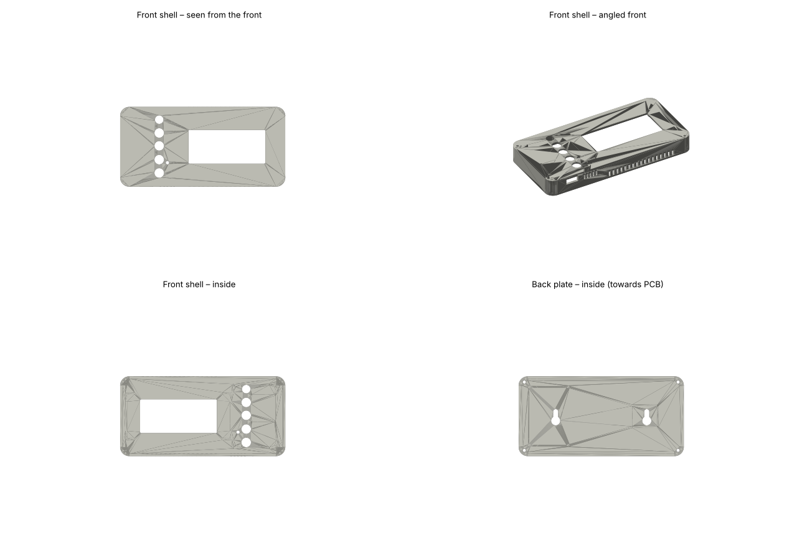

# Universal Room Board – Room Panel

A small ESP32-C6 board for Home Assistant that turns into a wall-mounted room panel:
mmWave presence, temperature, humidity, light and CO₂ sensing, a 2.9" e-paper
display, a rotary knob and four buttons for lights, blinds and scenes. Built around
a Seeed XIAO ESP32-C6, assembled by JLCPCB, running ESPHome.

The same PCB can also drive a motorized IKEA HOPPVALS blind through the J2
expansion header (motor board, separate design).

## What's in this repo

| Folder | Contents |
| --- | --- |
| `hardware/BOM.csv` | Full bill of materials for one finished panel (PCB, modules, connectors, cables, case hardware) |
| `hardware/kicad/` | KiCad project (schematic, PCB, JLCPCB fabrication files) – add yours here |
| `hardware/case/` | Parametric case (CadQuery), printable STL and STEP files |
| `firmware/` | ESPHome configuration for the living-room panel |
| `docs/` | Assembly, Home Assistant setup and pin map |

## Hardware at a glance

| Part | Ref | Connection |
| --- | --- | --- |
| Seeed XIAO ESP32-C6 | U2 | Wi-Fi now, Thread later |
| DFRobot C4002 mmWave radar | J1 | UART 115200 (D6/D7), OUT → expander P4 |
| Sensirion SHT40 | U1 | I²C 0x44 |
| ROHM BH1750 | U4 | I²C 0x23 |
| SCD40 breakout | J4 | I²C 0x62, cable, sits behind the display |
| NXP PCA9554 expander | U5 | I²C 0x20 – buttons, knob press, display reset, radar OUT |
| Waveshare 2.9" e-paper V2 | J3 | SPI (D8 SCK, D10 MOSI, D9 CS, D1 DC, D0 BUSY) |
| Rotary encoder BMQ22 | SW1 | D2 / D3, push → expander P1 |
| 4 × tactile buttons | SW2–SW5 | Lights P2, Blinds P5, All off P7, Scene P3 |

Board: 37 × 54 mm, 2 layers. Case: 145 × 70 × 24 mm.

## Cost (one panel, Nov 2026)

About **$78** per panel excluding shipping and VAT — see `hardware/BOM.csv`.
The JLCPCB board with all SMD parts and the XIAO is about $17 of that; the
display, CO₂ breakout and radar make up most of the rest.

## Quick start

1. Order the PCB from `hardware/kicad` (JLCPCB, top-side assembly) and the parts in `hardware/BOM.csv`.
2. Solder J1 (radar socket), J3 (display) and J4 (CO₂ socket).
3. Print the case from `hardware/case/out` – see `docs/assembly.md`.
4. Flash the firmware – see `docs/home-assistant.md`.

## Status

First board batch ordered (rev 1). Values marked **CHECK** in the case script and
firmware are estimates to verify against the real board.
